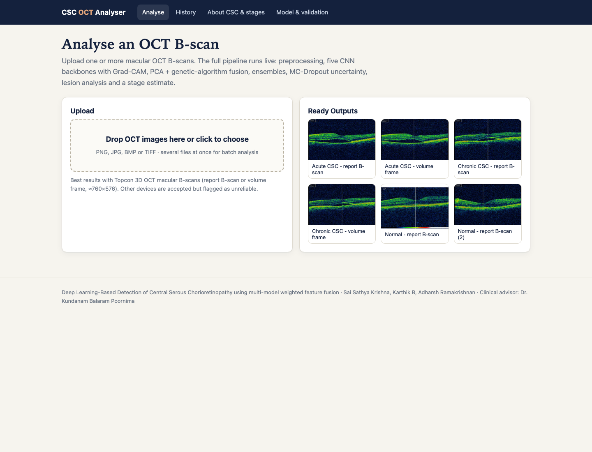
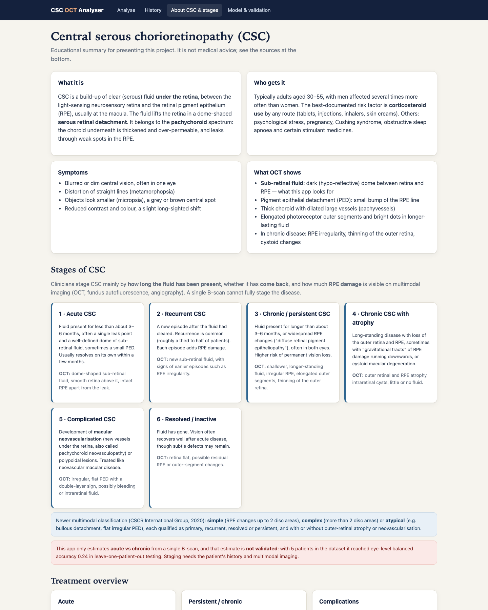

# CSC Detection from OCT: Multi-Model Weighted Feature Fusion

> This repository documents the project (description, method, results, screenshots). The source code lives in a private repository, `CSC-Retina-ML-code`.

**Live demo:** _deployment in progress_
**Project site:** [https://kart4206.github.io/CSC-Retina-ML/](https://kart4206.github.io/CSC-Retina-ML/)

Detects central serous chorioretinopathy (CSC) on retinal OCT B-scans by fusing five pretrained CNNs, and refers uncertain scans to a clinician. The study behind it also tests whether high benchmark scores come from the disease or from how the images were collected.

Research software. Not a medical device.

## What the app does

- Upload one or more OCT B-scans, or pick an example, and watch each stage run: preprocessing, five backbones with Grad-CAM, PCA and genetic-algorithm fusion, the ensembles, UAGF, NSGA-II operating points and MC-dropout uncertainty.
- Get a decision (CSC detected, no CSC, or refer) in screening mode (P(CSC) ≥ 0.35, chosen to keep at least 95% specificity on validation patients) or balanced mode (0.5).
- Read a full report with Grad-CAM, a region-of-interest overlay, every pipeline output and an experimental acute/chronic estimate, and download it as a PDF.

## Method

| Stage | Detail |
|---|---|
| Data | Composite same-scanner dataset (Hassan, Akram and Nazir, 2021) with patient IDs and acute/chronic labels; Retinal OCT-C8; OCTID for external testing |
| Preprocessing | Grayscale, crop, p1 to p99.5 normalisation, optional harmonisation (2× downsample, Gaussian blur σ = 1, JPEG q = 70), 224 × 224 |
| Evaluation | Patient-grouped nested cross-validation, 5 seeds, patient-level bootstrap intervals |
| R1 | ResNet-34, ResNet-50, DenseNet-121, EfficientNet-B0, MobileNetV3-Large; Top-4 chosen on validation |
| R2 / R3 | PCA (32 components per model) and GA block weights fitted on out-of-fold features; MLP fusion head |
| Ensembles | Average, temperature-scaled, GA probability weights, uncertainty-aware gated fusion (UAGF), cross-attention |
| Operating points | NSGA-II over sensitivity, specificity and model count; balanced and screening points |
| Uncertainty | MC dropout, 20 passes, refer-to-clinician selective prediction |
| Controls | No-CNN shortcut probes, shuffled-label and thumbnail-only controls, matched-type evaluation, cross-dataset tests, Grad-CAM tissue analysis |

More detail: [docs/ARCHITECTURE.md](docs/ARCHITECTURE.md).

## Results (same-scanner dataset, 5 seeds × 4 folds)

| Method | AUC per seed | Balanced accuracy | Sensitivity | Specificity | Matched-type AUC |
|---|---|---|---|---|---|
| R1 M1 alone | 0.932 ± 0.018 | 0.849 ± 0.025 | 0.894 | 0.805 | 0.792 |
| R2 GA-weighted M2–M4 | 0.851 ± 0.052 | 0.768 ± 0.045 | 0.751 | 0.786 | 0.723 |
| R3 full fusion | 0.700 ± 0.110 | 0.646 ± 0.082 | 0.735 | 0.557 | 0.735 |
| Average ensemble | 0.954 ± 0.010 | 0.909 ± 0.016 | 0.885 | 0.933 | 0.783 |
| Temperature-scaled ensemble | 0.938 ± 0.016 | 0.890 ± 0.032 | 0.865 | 0.914 | 0.756 |
| GA probability weights | 0.903 ± 0.044 | 0.834 ± 0.068 | 0.820 | 0.848 | 0.688 |
| UAGF | 0.913 ± 0.037 | 0.854 ± 0.047 | 0.823 | 0.886 | 0.729 |
| NSGA-II balanced point | 0.924 ± 0.018 | 0.878 ± 0.027 | 0.855 | 0.900 | 0.774 |
| NSGA-II screening point | 0.924 ± 0.022 | 0.849 ± 0.021 | 0.898 | 0.800 | 0.735 |
| MC-dropout ensemble | 0.954 ± 0.009 | 0.913 ± 0.015 | 0.887 | 0.938 | 0.783 |
| Cross-attention fusion | 0.734 ± 0.102 | 0.655 ± 0.084 | 0.576 | 0.733 | 0.723 |

- The average and MC-dropout ensembles performed best. GA-weighted feature fusion (R2, R3) did not beat the best single model, because each training fold held only two CSC patient groups.
- Referring the 30% most uncertain scans raised MC-dropout balanced accuracy from 0.913 to 0.949.
- Retinal OCT-C8 can be separated from 16 × 16 thumbnails or image size alone (AUC 1.000), so near-perfect scores on it are not evidence of CSC detection.
- Comparing only images exported the same way (matched type), the AUC is about 0.78. With shuffled training labels it falls to 0.437 to 0.502, which shows the pipeline does not leak labels.

Full tables and figures: [docs/RESULTS.md](docs/RESULTS.md).

## Screenshots

| | |
|---|---|
|  |  |
|  |  |

## Tech stack

Python, PyTorch and torchvision, scikit-learn, DEAP (GA and NSGA-II), Flask with server-sent events, Matplotlib (PDF reports). The live demo runs in a Docker container on a Hugging Face Space (CPU).

## Limitations

- Only five CSC patients in the same-scanner data, so all intervals are wide.
- Healthy images there are report screenshots while most CSC images are volume frames; the matched-type AUC controls for this but rests on eight CSC screenshots.
- Models do not transfer to other scanners in the cross-dataset tests (AUC 0.435 and 0.600).
- Acute versus chronic subtyping on five patients failed and is shown only as an experimental estimate.

## Authors

Sai Sathya Krishna A R, Karthik B, Adharsh Ramakrishnan, and Dr. Swaminathan A (supervisor). Clinical guidance: Dr. Kundanam Balaram Poornima. School of Computer Science and Engineering, Vellore Institute of Technology, Chennai.
