# CSC Detection from OCT: project report

**Deep learning-based automated detection and subtyping of central serous chorioretinopathy (CSC) using optimized multi-model weighted feature fusion**

Sai Sathya Krishna A R, Karthik B, Adharsh Ramakrishnan, and Dr. Swaminathan A (supervisor)
Clinical guidance: Dr. Kundanam Balaram Poornima
School of Computer Science and Engineering, Vellore Institute of Technology, Chennai

Research software. Not a medical device.

## Contents

1. Summary
2. Clinical background
3. Motivation and objectives
4. Data
5. Method
6. Evaluation protocol
7. Results
8. Discussion
9. The application
10. Reproducing the study
11. Limitations and future work
12. References

## 1. Summary

The project detects central serous chorioretinopathy (CSC) on OCT B-scans with an optimised fusion of five pretrained CNNs and asks a second question alongside: do high scores come from the disease or from how the images were collected? It makes four contributions:

1. **Leak-free multi-model fusion (R1 → R2 → R3).** Four of five backbones are chosen on validation data; their features are compressed with PCA and weighted by a genetic algorithm whose fitness is a patient-grouped cross-validated log-loss on out-of-fold features. Two new fusion rules are added: uncertainty-aware gated fusion (UAGF) and a cross-attention head.
2. **NSGA-II Pareto fusion.** Fusion is posed as a three-objective problem (sensitivity, specificity, number of models), giving balanced and screening operating points chosen on training data only.
3. **Uncertainty-aware referral.** An MC-dropout ensemble refers the most uncertain scans to a clinician.
4. **A shortcut-controlled evaluation protocol.** Canonical preprocessing with harmonisation, patient-grouped nested cross-validation over five seeds, no-CNN shortcut probes, shuffled-label and thumbnail controls, matched-type evaluation and patient-level bootstrap intervals.

On the same-scanner dataset, simple probability ensembles performed best (per-seed AUC 0.954). Referring the 30% most uncertain scans raised MC-dropout balanced accuracy from 0.913 to 0.949. GA-weighted feature fusion (R2 0.851, R3 0.700) did not beat the best single backbone, because each training fold held only two CSC patient groups. The widely used Retinal OCT-C8 benchmark turned out to be separable from 16 × 16 thumbnails (AUC 1.000), and controlling for export type reduced the same-scanner AUC from about 0.96 to a matched-type AUC of about 0.78.

## 2. Clinical background

CSC is a serous detachment of the neurosensory retina at the posterior pole. Subretinal fluid leaks through defects in the retinal pigment epithelium (RPE) from a hyperpermeable, congested choroid and collects between the photoreceptors and the RPE. It typically affects adults aged 20 to 50, more often men, and is associated with corticosteroid use and stress. Patients notice blurred or distorted central vision, micropsia and a central scotoma.

Acute CSC shows a dome-shaped detachment, often with a small pigment epithelial detachment at the leak, and usually resolves within three to four months. Chronic CSC has persistent or recurrent fluid, diffuse RPE damage, shallow irregular detachments and eventually photoreceptor loss, and is usually treated (for example with photodynamic therapy or micropulse laser). On OCT both appear as dark fluid under an elevated retina, and telling them apart is hard even for specialists.

## 3. Motivation and objectives

Published CSC classifiers mostly use one CNN, one fixed threshold and random image-level splits of public data. A preliminary benchmark in this project showed the risk: eight backbones trained for one epoch on Retinal OCT-C8 reached validation accuracies of 0.8757 to 1.0000, with four tied at exactly 1.0000. Saturated scores cannot rank models and leave nothing for fusion to improve, and they raised the question of whether the networks were detecting CSC at all.

The objectives were to benchmark backbones (R1), compress and weight their features (R2), fuse them with the primary model (R3), compare against probability-level ensembles, add multi-objective operating points and uncertainty-based referral, and evaluate everything under a protocol that controls for leakage and shortcuts.

## 4. Data

| Dataset | Content | Labels used | Role |
|---|---|---|---|
| Same-scanner composite (Hassan, Akram and Nazir, 2021) | Topcon exports per patient and eye; volume frames and report screenshots | Healthy, acute CSR, chronic CSR | Primary benchmark; only source of subtype labels and patient IDs |
| Retinal OCT-C8 (Kaggle) | 24,000 B-scans, 8 classes, no patient IDs | Normal, CSR (600 per class) | Second benchmark |
| OCTID (Gholami et al., 2020) | Over 500 B-scans, 5 classes | Normal, CSR | External test only |

Patients in the same-scanner data are identified by the scanner patient ID in the file names. Exact duplicates are removed by MD5 hash and near-duplicates (64-bit perceptual hash, Hamming distance ≤ 4) are kept in one group so they never straddle a split.

| Quantity | Same-scanner | OCT-C8 subset | OCTID |
|---|---|---|---|
| Images used, normal / CSC | 42 / 264 | 595 / 595 | 205 / 102 |
| Groups | 32 | 1,190 | 307 |
| Image kinds | 256 frames, 50 screenshots | n/a | n/a |

Only five same-scanner patients have CSC (three acute, two chronic), forming four groups. All 42 normal images are report screenshots, while 256 of 264 CSC images are volume frames. This export-type imbalance is controlled by the matched-type evaluation.

## 5. Method

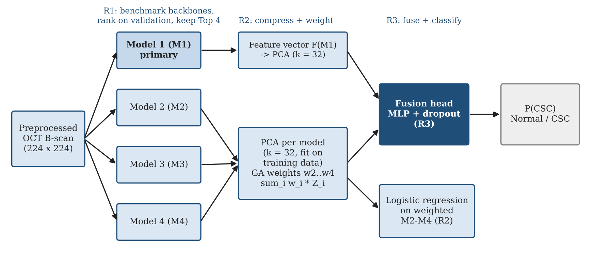

### 5.1 Canonical preprocessing and harmonisation

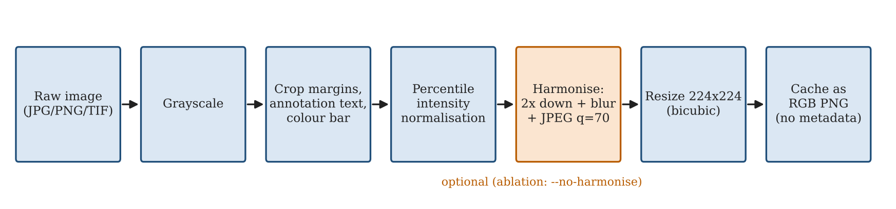

Every image takes the same path: grayscale, crop of overlay text and colour bar, percentile normalisation g′ = clip((g − P1) / (P99.5 − P1), 0, 1), optional harmonisation H(I) = JPEG₇₀(G_σ=1 ∗ Downsample₂(I)), and a 224 × 224 bicubic resize. Harmonisation removes fine differences in resolution, sharpening and compression between export types; its effect is measured by an ablation.

### 5.2 Patient-grouped nested cross-validation

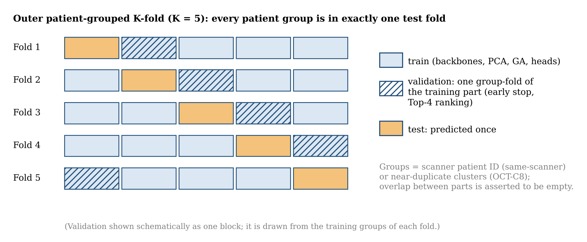

All splits are made over groups. The outer level tests each group once (four folds on the same-scanner data, each with one CSC group); a validation subset handles early stopping and backbone ranking; inner folds produce out-of-fold features for the meta stage. Everything is repeated for five seeds, and assertions fail the run if any group or eye appears in two parts.

### 5.3 R1: backbones

ResNet-34, ResNet-50, DenseNet-121, EfficientNet-B0 and MobileNetV3-Large (ImageNet) are fine-tuned with half their parameters frozen, a Dropout(0.3) + Linear head, AdamW (10⁻³ head, 10⁻⁴ backbone), cosine annealing over 15 epochs, label smoothing 0.1, class-weighted sampling and early stopping. The four with the best validation score become M1 to M4.

### 5.4 R2 and R3: PCA and genetic-algorithm fusion

Each model's out-of-fold features are standardised and projected onto 32 whitened principal components, z_i. R2 concatenates the secondary blocks with GA weights on the simplex, x_R2 = [w2 z2, w3 z3, w4 z4], and the GA (DEAP; population 24, 25 generations) minimises the grouped three-fold cross-validated log-loss of a logistic regression. R3 concatenates z1 with x_R2 (128 features) and classifies them with a small MLP whose width and dropout are chosen by grouped cross-validation.

### 5.5 Probability ensembles and UAGF

The Top-4 probabilities are combined by plain averaging, temperature-scaled averaging, GA weights and UAGF. UAGF weights each model per image by the binary entropy of its calibrated probability:

H_i(x) = −p_i ln p_i − (1 − p_i) ln(1 − p_i),  g_i(x) = softmax_i(a_i − β H_i(x)),  p_UAGF(x) = Σ_i g_i(x) p_i(x)

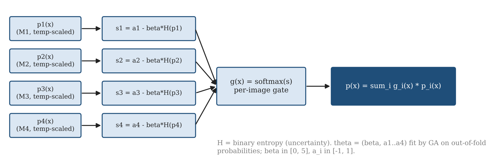

### 5.6 NSGA-II Pareto fusion

Each candidate encodes four weights and a threshold. NSGA-II (population 40, 30 generations) maximises sensitivity and specificity and minimises the number of models with weight above 0.05. The balanced point maximises balanced accuracy on the Pareto front; the screening point maximises specificity subject to sensitivity ≥ 0.95. Both are chosen on out-of-fold training data.

### 5.7 MC-dropout and refer-to-clinician

Each Top-4 head runs 20 passes with dropout p = 0.3. The mean P(CSC) over passes and models is the prediction and the mean of per-model variances is the uncertainty. Test scans are ranked by uncertainty and the most certain 100%, 90%, 80% or 70% are kept.

### 5.8 Shortcut probes and controls

Before any CNN is trained, a random forest is evaluated on features that cannot encode lesion shape: raw image and file size, a 16 × 16 thumbnail, intensity and texture statistics, and export type within the CSC class. A gated probe above AUC 0.70 stops the run unless forced. A shuffled-label control permutes training labels at the group level, and a thumbnail CNN bounds what global appearance alone can achieve.

## 6. Evaluation protocol

Metrics are AUC, balanced accuracy, sensitivity, specificity, F1, MCC and ECE. Each method is reported per seed (mean ± SD) and after averaging predictions over seeds, with 95% patient-level bootstrap intervals (1,000 resamples). On the same-scanner data the headline is the matched-type AUC on screenshots only (50 images, 8 CSC), where both classes share the export path.

## 7. Results

### 7.1 Shortcut probes

| Probe | Same-scanner (harmonised) | Same-scanner (not harmonised) | OCT-C8 |
|---|---|---|---|
| Raw image size | 0.987 | 0.987 | 1.000 |
| Raw file size | 0.950 | 0.950 | 0.896 |
| 16 × 16 thumbnail | 0.706 | 0.711 | 0.998 |
| Texture / intensity | 0.420 | 0.826 | 1.000 |
| PNG size | 0.532 | 0.364 | 0.690 |
| Export type (CSC only) | 0.693 | 0.692 | n/a |

On OCT-C8 a random forest on a 16 × 16 thumbnail separates the classes with AUC 0.998 and simple intensity statistics reach 1.000, because the classes were acquired at different resolutions. On the same-scanner data, harmonisation removed the texture cue (0.826 → 0.420).

### 7.2 Backbones (R1)

| Backbone | AUC | Balanced accuracy | Times in Top-4 (of 20) |
|---|---|---|---|
| ResNet-34 | 0.940 ± 0.046 | 0.870 ± 0.082 | 20 |
| ResNet-50 | 0.887 ± 0.075 | 0.783 ± 0.089 | 16 |
| DenseNet-121 | 0.950 ± 0.038 | 0.889 ± 0.063 | 19 |
| EfficientNet-B0 | 0.898 ± 0.115 | 0.801 ± 0.135 | 17 |
| MobileNetV3-Large | 0.846 ± 0.086 | 0.680 ± 0.122 | 8 |

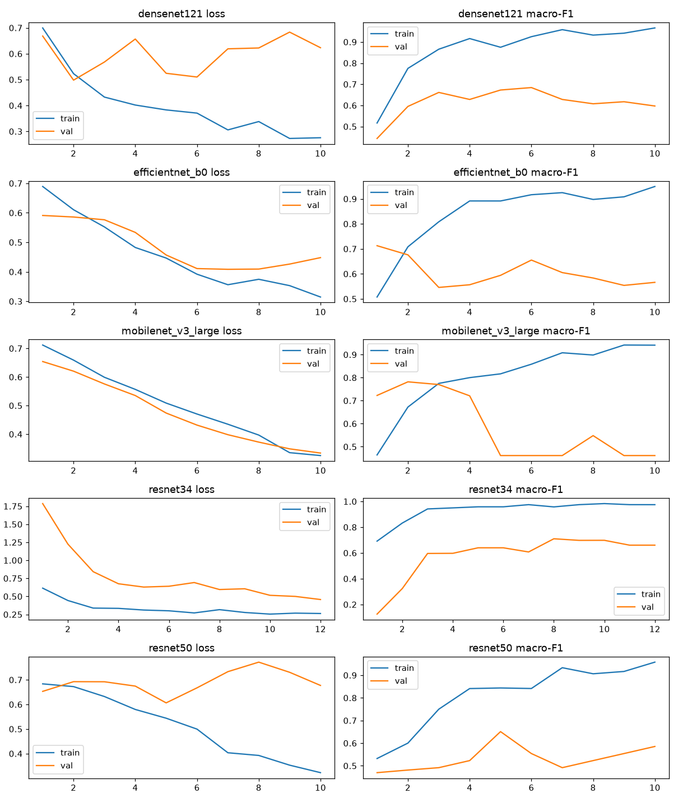

Training macro-F1 reached 0.93 to 0.98 while validation macro-F1 peaked at about 0.65 to 0.78, a large generalisation gap that reflects the small number of patients.

### 7.3 Fusion compared

| Method | AUC per seed | AUC ensembled [95% CI] | Balanced accuracy | Sensitivity | Specificity | MCC | ECE |
|---|---|---|---|---|---|---|---|
| R1 M1 alone | 0.932 ± 0.018 | 0.963 [0.922, 0.995] | 0.849 ± 0.025 | 0.894 | 0.805 | 0.601 | 0.120 |
| R2 GA-weighted M2–M4 | 0.851 ± 0.052 | 0.930 [0.854, 0.992] | 0.768 ± 0.045 | 0.751 | 0.786 | 0.398 | 0.126 |
| R3 full fusion | 0.700 ± 0.110 | 0.932 [0.820, 1.000] | 0.646 ± 0.082 | 0.735 | 0.557 | 0.221 | 0.275 |
| Average ensemble | 0.954 ± 0.010 | 0.963 [0.917, 0.996] | 0.909 ± 0.016 | 0.885 | 0.933 | 0.675 | 0.160 |
| Temperature-scaled ensemble | 0.938 ± 0.016 | 0.952 [0.893, 0.996] | 0.890 ± 0.032 | 0.865 | 0.914 | 0.633 | 0.106 |
| GA probability weights | 0.903 ± 0.044 | 0.928 [0.854, 0.994] | 0.834 ± 0.068 | 0.820 | 0.848 | 0.527 | 0.083 |
| UAGF | 0.913 ± 0.037 | 0.931 [0.858, 0.994] | 0.854 ± 0.047 | 0.823 | 0.886 | 0.564 | 0.071 |
| NSGA-II balanced point | 0.924 ± 0.018 | 0.948 [0.882, 0.997] | 0.878 ± 0.027 | 0.855 | 0.900 | 0.605 | 0.096 |
| NSGA-II screening point | 0.924 ± 0.022 | 0.945 [0.881, 0.997] | 0.849 ± 0.021 | 0.898 | 0.800 | 0.606 | 0.075 |
| MC-dropout ensemble | 0.954 ± 0.009 | 0.964 [0.917, 0.996] | 0.913 ± 0.015 | 0.887 | 0.938 | 0.682 | 0.170 |
| Cross-attention fusion | 0.734 ± 0.102 | 0.935 [0.845, 0.997] | 0.655 ± 0.084 | 0.576 | 0.733 | 0.217 | 0.250 |

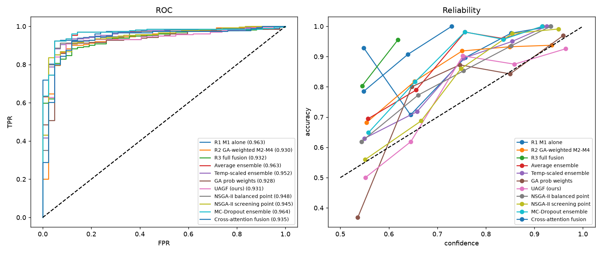

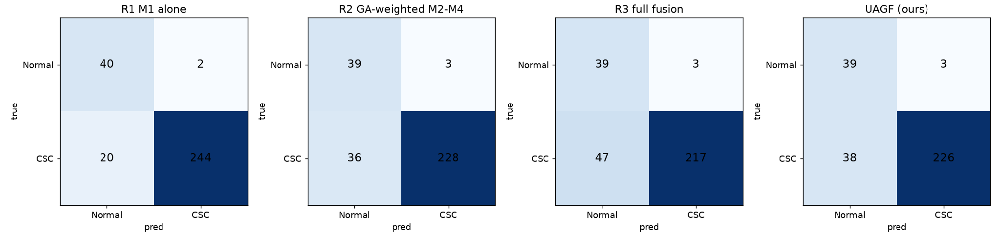

The expected R1 → R2 → R3 improvement did not appear. R2 (0.851) and R3 (0.700) were both worse than M1 alone (0.932). The average and MC-dropout ensembles were best (0.954) with the highest MCC and the least variation across seeds. UAGF and the GA probability weights did not beat plain averaging but were among the best calibrated (ECE 0.071 and 0.083). NSGA-II delivered the intended trade-off: higher sensitivity at the screening point (0.898) and higher specificity at the balanced point (0.900) than M1 (0.894 and 0.805).

### 7.4 Why feature fusion lost

| Quantity (seed 0, fold 0) | Value |
|---|---|
| GA feature weights | ResNet-34 0.22, DenseNet-121 0.76, ResNet-50 0.02; CV log-loss 0.474 → 0.471 |
| UAGF parameters | β and two biases ended at their bounds |
| Temperatures | ResNet-50 0.11, MobileNetV3-Large 0.26 (very under-confident) |
| NSGA-II balanced point | Out-of-fold sens 0.919 / spec 0.952 → test 0.855 / 0.900 |

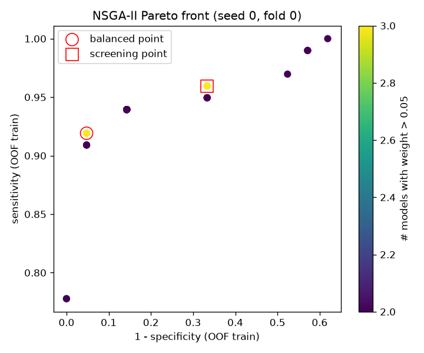

Each training part contained only two CSC patient groups, so every GA fitness, fusion head and Pareto front was estimated from two CSC patients, and out-of-fold features came from different networks than test features. Methods that learn from features suffered most; methods that only average probabilities suffered least.

### 7.5 Matched-type evaluation

Comparing only screenshots (50 images, 8 CSC), the AUC fell from about 0.93 to 0.96 to between 0.688 and 0.792. Every method detected 83% to 94% of CSC volume frames but only 12.5% to 50% of CSC screenshots. The most reliable estimate for this dataset is a matched-type AUC of about 0.78 (M1 0.792, MC-dropout 0.783), with a 95% interval of roughly 0.46 to 0.97.

### 7.6 Harmonisation ablation

| Method | All, harmonised | All, not harmonised | Matched, harmonised | Matched, not harmonised |
|---|---|---|---|---|
| R1 M1 alone | 0.932 | 0.971 | 0.792 | 0.777 |
| R3 full fusion | 0.700 | 0.620 | 0.735 | 0.497 |
| UAGF | 0.913 | 0.906 | 0.729 | 0.637 |
| MC-dropout ensemble | 0.954 | 0.967 | 0.783 | 0.771 |

Harmonisation costs a little all-image AUC but improves every method on the matched-type comparison, most of all the feature-level methods.

### 7.7 Refer to clinician

| Uncertainty | 100% kept | 90% | 80% | 70% |
|---|---|---|---|---|
| MC-dropout variance | 0.913 | 0.926 | 0.936 | 0.949 |
| UAGF entropy | 0.854 | 0.882 | 0.901 | 0.914 |

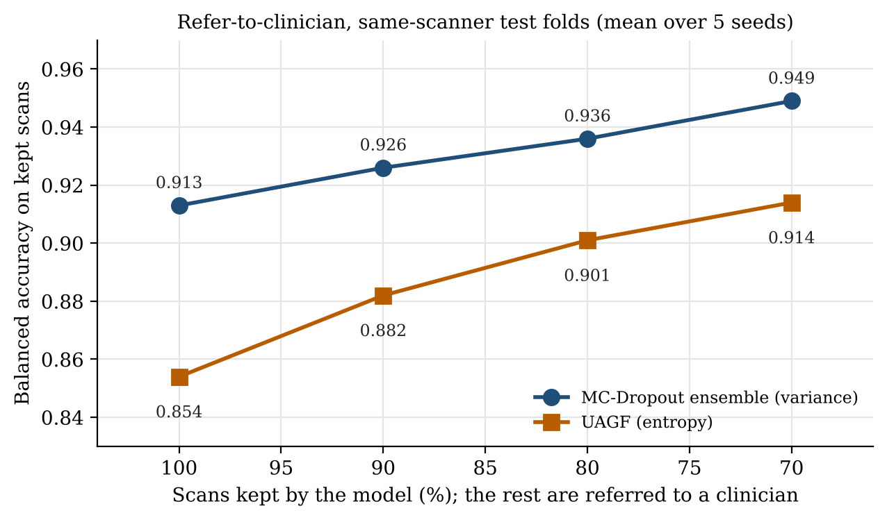

Referring the 30% most uncertain scans raised balanced accuracy on the rest from 0.913 to 0.949, and the gain was monotonic. This is the most useful practical result: the system can run at a chosen referral rate with a known accuracy on the scans it decides.

### 7.8 Controls and explainability

| Control | Same-scanner | OCT-C8 |
|---|---|---|
| Shuffled labels, M1 AUC | 0.437 | 0.218 |
| Shuffled labels, R3 AUC | 0.502 | 0.549 |
| Thumbnail-only CNN, AUC | 0.867 | 1.000 |

With shuffled labels the same-scanner AUCs sit near 0.5, so the pipeline does not leak labels. On OCT-C8 the shuffled M1 AUC falls far below 0.5, which is what two trivially separable clusters produce, not label leakage.

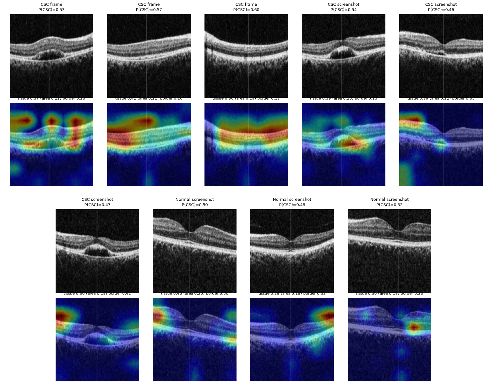

On the same-scanner data 0.37 of the Grad-CAM mass falls on retinal tissue that covers 0.20 of the image, about 1.8 times its area share. On OCT-C8 the maxima sit on an export overlay marker:

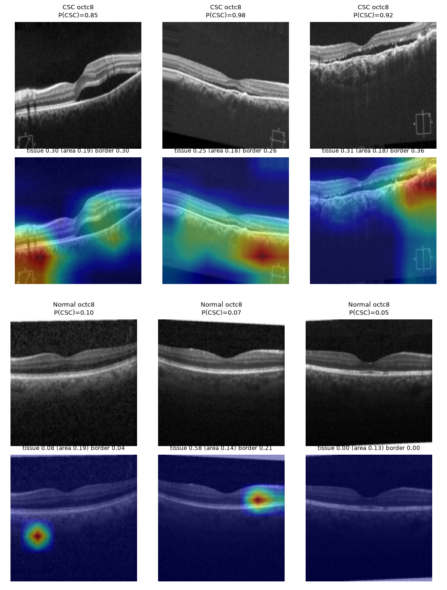

### 7.9 Cross-dataset and subtyping

| Trained on → tested on | AUC |
|---|---|
| Same-scanner → same-scanner | 0.912 |
| Same-scanner → OCTID | 0.435 |
| Same-scanner → OCT-C8 | 0.600 |
| OCT-C8 → OCTID | 1.000 |
| OCT-C8 → same-scanner screenshots | 0.711 |

Models do not transfer between scanners. OCT-C8 → OCTID is perfect only because the two public datasets share sources.

Acute versus chronic subtyping (leave-one-patient-out on five patients) gave an eye-level balanced accuracy of 0.240 ± 0.049, systematically inverted. With two chronic patients, the model can only learn one person's appearance, so five patients cannot support subtyping.

## 8. Discussion

The results separate what can and cannot be claimed. OCT-C8 scores, including the preliminary 100% accuracies, are not evidence of CSC detection. On the same-scanner data the models reach all-image AUCs of 0.93 to 0.96 and attend to the retina, but the matched-type AUC is about 0.78 and performance does not transfer to other scanners. Within these limits, simple probability ensembles are the best performers, NSGA-II gives selectable operating points, and uncertainty-based referral reliably improves accuracy on the scans the system keeps. Feature-level fusion needs more patients and a dedicated meta set before it can be judged fairly.

## 9. The application

The CSC OCT Analyser is a Flask web app that runs the whole pipeline on an uploaded scan and streams each stage live: input check, preprocessing, five backbones with Grad-CAM, PCA and GA fusion, ensembles, UAGF, NSGA-II, MC-dropout, a heuristic region-of-interest overlay, an experimental stage estimate and the decision. Screening mode (P(CSC) ≥ 0.355, the lowest threshold keeping at least 95% specificity on validation patients) is the default, and scans in the grey zone or with disagreeing models are marked uncertain. Each analysis produces a web report and a PDF. With `CSC_PUBLIC=1` the history page lists nothing and uploads are deleted after analysis.

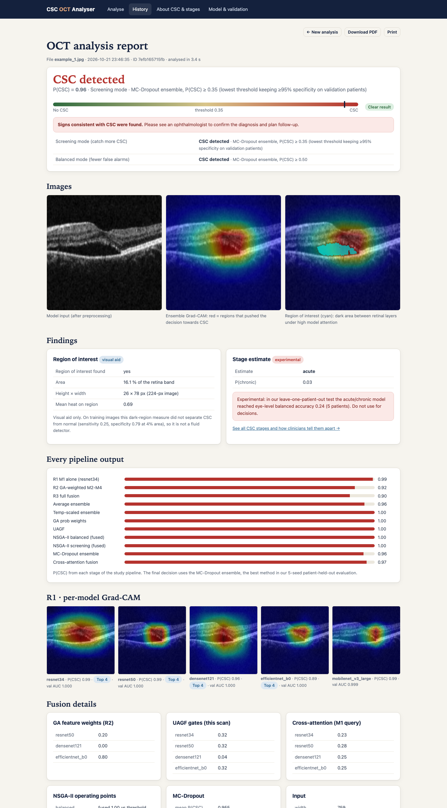

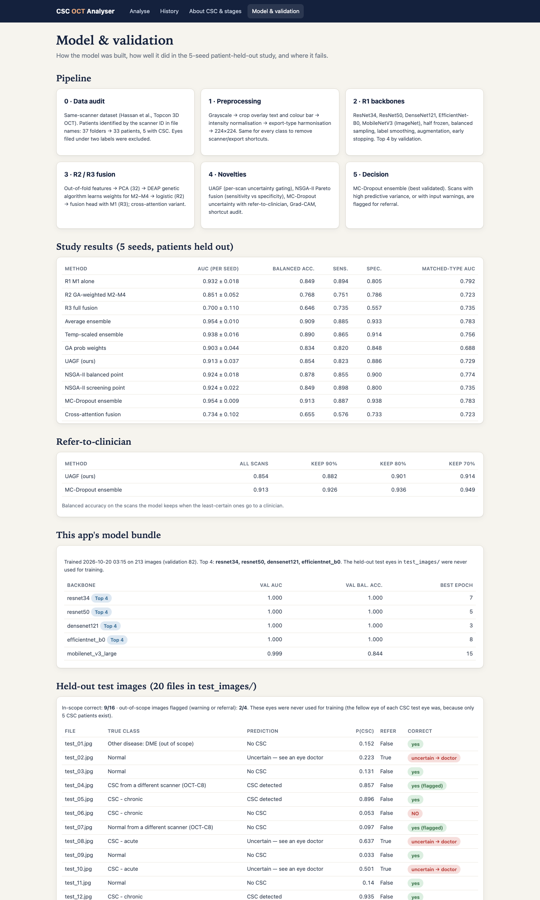

## 10. Reproducing the study

```bash
cd csc_v3 && zsh run_mac.sh      # full study, about 4 to 6 hours on an Apple-silicon Mac
zsh csc_app/run.sh               # web app on http://localhost:5050
```

A Colab notebook runs the same code on an NVIDIA T4. Datasets are downloaded from Kaggle and Mendeley Data.

## 11. Limitations and future work

- Five CSC patients in the same-scanner data; all intervals are wide.
- Export-type confound; the matched-type estimate rests on eight CSC screenshots.
- No transfer to other scanners.
- Out-of-fold and test features come from different networks; a blending design with a dedicated meta set would fix this.
- Several ablations and controls used one seed.

Future work: one device and export path with 30 or more patients, a blending meta stage, clinician-annotated acute and chronic labels on OCT volumes, a referral analysis by image type, retinal foundation models and volume-level aggregation, and external validation on another hospital's scanner.

## 12. References

1. T. Hassan, M. U. Akram and M. N. Nazir, "A composite retinal fundus and OCT dataset with detailed clinical markings of retinal layers and retinal lesions," Mendeley Data, v4, 2021.
2. P. Gholami et al., "OCTID: Optical coherence tomography image database," *Comput. Electr. Eng.*, vol. 81, 106532, 2020.
3. J. Yoon et al., "Classifying central serous chorioretinopathy subtypes with a deep neural network using optical coherence tomography images," *Sci. Rep.*, vol. 12, 422, 2022.
4. A. Daruich et al., "Central serous chorioretinopathy: Recent findings and new physiopathology hypothesis," *Prog. Retin. Eye Res.*, vol. 48, pp. 82–118, 2015.
5. K. Deb et al., "A fast and elitist multiobjective genetic algorithm: NSGA-II," *IEEE Trans. Evol. Comput.*, vol. 6, no. 2, pp. 182–197, 2002.
6. Y. Gal and Z. Ghahramani, "Dropout as a Bayesian approximation," in *Proc. ICML*, 2016, pp. 1050–1059.
7. R. Geirhos et al., "Shortcut learning in deep neural networks," *Nat. Mach. Intell.*, vol. 2, pp. 665–673, 2020.
8. J. R. Zech et al., "Variable generalization performance of a deep learning model to detect pneumonia in chest radiographs," *PLOS Med.*, vol. 15, e1002683, 2018.
9. D. S. Kermany et al., "Identifying medical diagnoses and treatable diseases by image-based deep learning," *Cell*, vol. 172, pp. 1122–1131, 2018.
10. F.-A. Fortin et al., "DEAP: Evolutionary algorithms made easy," *J. Mach. Learn. Res.*, vol. 13, pp. 2171–2175, 2012.
